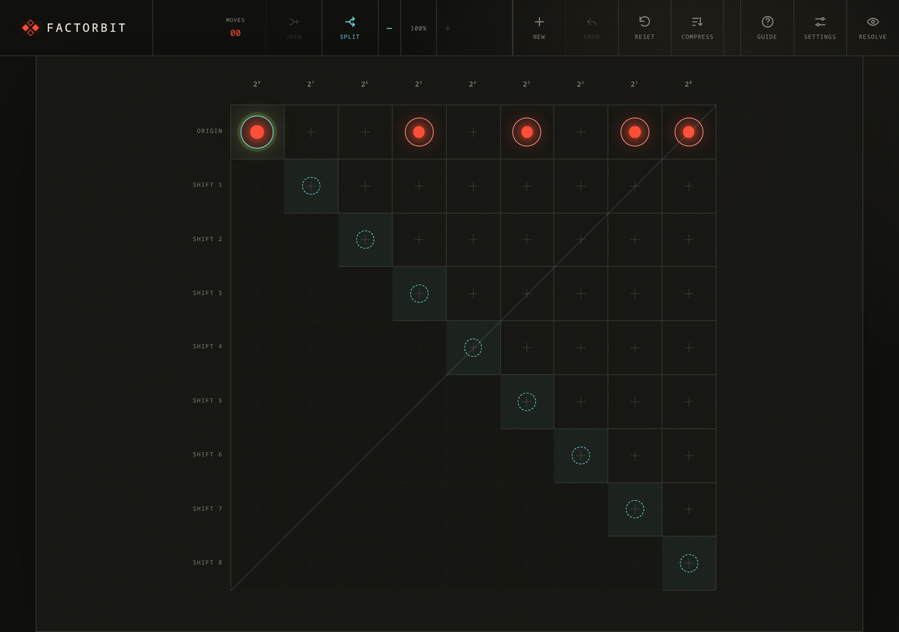

# Factorbit

A visual factorization puzzle: split, join, and move binary signals to reveal a number’s hidden factors.



## How to play

Start with a composite number represented in binary. Rearrange its signals into a multiplication pattern that reveals the two factors. Both factor orderings count as a solution.

- **Move** a signal along its highlighted diagonal to keep its value.
- **Split** one signal into two signals to the right, each worth half as much.
- **Join** two signals at the same position into one signal to the left, worth twice as much.

Use **Undo** to reverse a move, **Reset** to restart the puzzle, or **Guide** to load a training puzzle. **Resolve** displays the solution patterns. **Settings** lets you choose factor ranges and enable experimental unbounded splits or fractional joins.

## Run locally

Requires Node.js 24 or later and npm.

```sh
npm ci
npm run dev
```

Open the local URL printed in the terminal.

## Build

```sh
npm run check
npm run build
npm run preview
```

The production build is written to `dist/`. The preview command serves that build locally.

## Keyboard shortcuts

| Key | Action |
| --- | --- |
| `N` | New puzzle |
| `R` | Reset puzzle |
| `Z` | Undo |
| `H` or `?` | Toggle guide |
| `G` | Toggle settings |
| `S` | Toggle solution |
| `←` / `→` | Join / split the selected signals |
| `−` / `+` | Decrease / increase board size |

Built with Svelte 5, TypeScript, and Vite.
